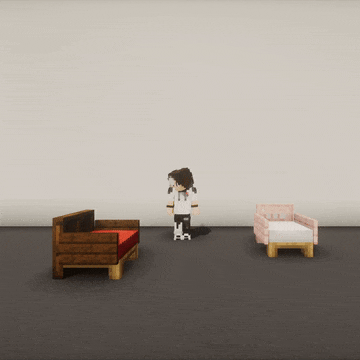
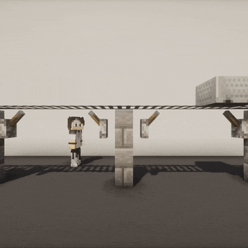
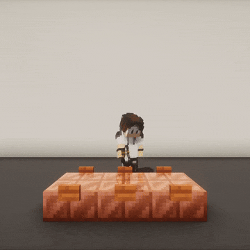
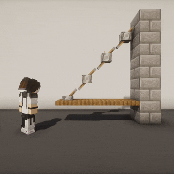
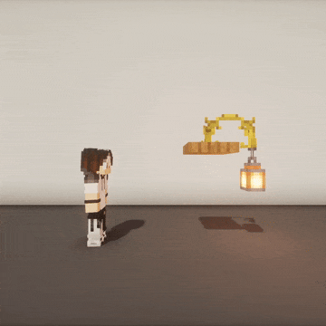
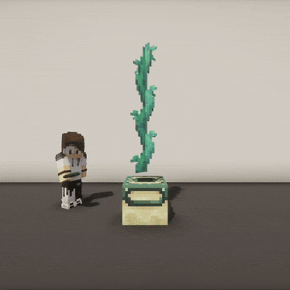
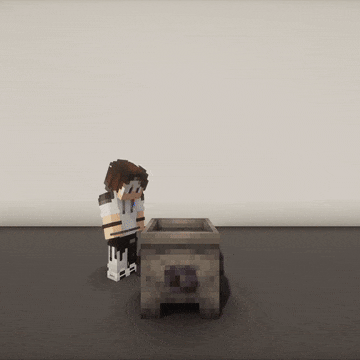
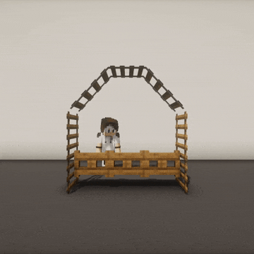

# Keep Illegal Blocks

[](https://github.com/Atrimilan/KeepIllegalBlocks/actions/workflows/release.yml)
&nbsp;[](https://modrinth.com/plugin/keep-illegal-blocks)
&nbsp;[](https://github.com/Atrimilan/KeepIllegalBlocks/blob/master/LICENSE)

Paper plugin that prevents illegal blocks from breaking or being updated when a player interacts with an adjacent
block.

<table>
  <tr>
    <td></td>
    <td></td>
  </tr>
</table>

<details>
<summary><b>🖼️ More GIF examples</b></summary>
<br/>

There you go 😎:

<table>
  <tr>
    <td></td>
    <td></td>
    <td></td>
  </tr>
  <tr>
    <td></td>
    <td></td>
    <td></td>
  </tr>
  <tr>
    <td></td>
    <td></td>
    <td></td>
  </tr>
</table>
</details>

## Overview

### 1. What's the point?

When you place a block in a way that the game's physics normally wouldn't allow, they may break or update once you
interact with an adjacent block.

When an illegally placed block breaks or updates, its own adjacent blocks can be affected too, causing a chain reaction.

For example, these illegal blocks can be placed in the following ways:

* Force-placed with Axiom and its "No update" feature
* Force-placed with WorldEdit with `//perf off`
* Force-placed with the `/setblock` Minecraft command in `strict` mode (that prevents triggering block updates)
* Updated with a Debug Stick

#### → This plugin fixes this behavior by restoring your illegally placed blocks.

<br/>

In KIB, illegal blocks are called **"reactives"**, and the blocks that can be interacted with are called
**"interactables"** (if they can trigger adjacent block updates).

<details>
<summary>🤔 I don't get it, give me some examples</summary>

* Place a torch on a door. When you open the door, the torch breaks.<br/>
  **→ The torch is "reactive", the door is "interactable".**

* Stack multiple doors vertically and open the bottom one. All doors above break.<br/>
  **→ All doors are "reactive", the bottom door is the "interactable" one.**

* Place a row of walls, then use a Debug Stick to create crenels, and use Axiom to add a button on each. When you press
  one button, all buttons break and all wall connections reset to their normal state.<br/>
  **→ Walls and buttons are "reactive", the pressed button is also "interactable".**

</details>

### 2. Why would I need it?

This may seem niche, but it can be very useful for specific builds made using plugins like WorldEdit or Axiom,
especially when using custom resource packs that significantly change block textures and models.

This may also interest you if other players come onto your map and are likely to interact with your builds and break
everything accidentally... 😅

### 3. Which blocks are involved?

<details>
<summary>🔵 List of reactive material categories</summary>
<br/>

List of reactive material categories that are automatically restored by KIB when broken or updated:

* `amethyst_clusters`
* `bamboos`
* `banners`
* `beds`
* `bells`
* `bushes`
* `cactus`
* `cakes`
* `carpets`
* `cave_vines` _- Cave vines + Cave vine plants_
* `chorus_plants` _- Chorus plants only (chorus flowers is in the "flowers" category)_
* `cocoa`
* `crops`
* `comparators`
* `corals` _- Does not apply to waterlogged corals_
* `dead_bushes`
* `doors`
* `dripleaves`
* `fences` _- Fences + Iron bars + Copper bars_
* `ferns` _- Ferns + Large ferns_
* `flowers`
* `frogspawn`
* `fungus`
* `glass_panes`
* `glow_lichens`
* `grass`
* `hanging_roots`
* `hanging_signs`
* `ladders`
* `lanterns`
* `leaf_litters`
* `lily_pads`
* `mangrove_propagules`
* `mushrooms`
* `nether_roots`
* `nether_sprouts`
* `nether_warts`
* `pressure_plates`
* `rails`
* `red_shrubs`
* `redstone_wires`
* `repeaters`
* `saplings`
* `scaffolding`
* `sculk_veins`
* `sea_pickles`
* `signs`
* `snow`
* `speleothems` _- Pointed dripstones + Sulfur spikes_
* `sugar_canes`
* `sweet_berry_bushes`
* `switches` _- Levers + Stone buttons + Wooden buttons_
* `torches`
* `tripwire_hooks`
* `twisting_vines` _- Twisting vines + Twisting vine plants_
* `vines`
* `walls`
* `weeping_vines` _- Weeping vines + Weeping vine plants_

</details>

<details>
<summary>🔴 List of interactable material categories</summary>
<br/>

List of interactable material categories recorded by KIB:

* `campfires`
* `candles`
* `cauldrons`
* `cave_vines` _- Taking vine berries (Cave vines + Cave vine plants)_
* `chiseled_bookshelves` _- Putting or taking a book from a chiseled bookshelf_
* `comparators`
* `composters`
* `copper_blocks` _- Non-plain copper blocks that can be waxed or scraped_
* `daylight_detectors`
* `doors`
* `end_portal_frames`
* `gates`
* `lecterns` _- Putting a book on a lectern_
* `levers`
* `repeaters`
* `stone_buttons`
* `sweet_berry_bushes` _- Taking bush berries_
* `trap_doors`
* `wooden_buttons`

</details>

### <a id="config"></a> 4. How do I configure?

<details>
<summary>👉 Configure KIB using commands</summary>
<br/>

The config.yml file can be edited in-game with the `/kib rule` and `/kib blacklist` commands.

<br/>

To see the current value of a rule, use `/kib rule <ruleName>`, and if you want to edit a rule, specify a proper value
at the end (based on the rule type). Here are some examples:

* `/kib rule max_blocks` → Displays the current value of the `max_blocks` rule
* `/kib rule max_blocks 100` → Sets `max_blocks` to `100` in config.yml
* `/kib rule only_use_kib_in_creative_mode false` → Sets `only_use_kib_in_creative_mode` to `false` in config.yml

> The `/kib rule` command requires the `kib.rule` permission.

<br/>

To blacklist a reactive or interactable material, use `/kib blacklist <interactable|reactive> <add|remove> <material>`.
This is useful if you want to prevent certain blocks from being restored, or stop specific block interactions from
triggering restoration. Here are some examples:

* `/kib blacklist interactable add minecraft:oak_button` → Adds `OAK_BUTTON` to the interactable blacklist
* `/kib blacklist reactive remove minecraft:oak_door` → Removes `OAK_DOOR` from the reactive blacklist (assuming it was
  previously added)

> The `/kib blacklist` command requires the `kib.blacklist` permission.

<br/>

If you have edited config.yml manually, you can reload the plugin with `/kib reload`. Note that you don't need to reload
the plugin after executing commands; this is only necessary if you edit the config.yml file manually.
> The `/kib reload` command requires the `kib.reload` permission.

<br/>

If you need help with commands, you can use `/kib help`. It will show you all available commands, with a short
description and usage example.
> Any `kib.*` permission automatically grants access to the `/kib help` command.

<br/>

You can use the `kib.admin` permission to easily grant access to all commands (this is equivalent to `kib.*`).

</details>

<details>
<summary>📄 Configure KIB in config.yml</summary>
<br/>

In your server directory, you can edit `./plugins/KeepIllegalBlocks/config.yml` to:

* Blacklist some reactive or interactable materials _(everything is enabled by default)_
* Change the maximum number of reactive blocks to restore _(default: 500)_
* Only allow KIB in creative mode _(default: true)_
* Use [PacketEvents](https://modrinth.com/plugin/packetevents) if it is detected _(default: true)_

To reload your configuration, use the `/kib reload` command (it requires the `kib.reload` permission for a non-op
player).

</details>

### 5. Can the restoration be any smoother?

**Yes, [PacketEvents](https://modrinth.com/plugin/packetevents) is highly recommended to improve client-side rendering
and performance.**

It is automatically detected by KIB, and it is used to tweak network packets and make restorations completely
transparent by canceling reactive block break sounds and particles, as well as hiding flickering during restoration.

To find out which version of PacketEvents is recommended, check the “Dependencies” section for the version of KIB you
want to install.

### 6. FAQ

**Why doesn't KIB restore my blocks when I break an adjacent block?**
> **KIB does not trigger when you break blocks manually (left-click);** it only restores blocks that were accidentally
> broken as a result of an interaction (right-click). This could be an improvement area, but I don't have time to work
> on it at the moment. However, [Axiom](https://modrinth.com/mod/axiom) has a "No update" feature for this use case.

**Does it work underwater?**
> **KIB does not support underwater restorations.** That's why `seagrass` and `kelp` are not included in the list of
> reactive materials. For now, I have only focused on protecting illegal structures in the air; making this work
> underwater might not be easy, since the water flow would trigger multiple updates.

**Does KIB prevent natural updates?**
> Even after being restored by KIB, some reactive blocks will still update naturally, such as cactus breaking as they
> grow, or coral dying when not waterlogged. **This is the default behavior of the game, KIB will NOT prevent this**,
> even if they were initially placed using plugins like WorldEdit or Axiom (which rely on advanced chunk management
> systems).

## Server admin guide

### Installation

Download the plugin from Modrinth: https://modrinth.com/plugin/keep-illegal-blocks

Place the JAR file in the `./plugins` directory of your server.

> [!TIP]
> The [PacketEvents](https://modrinth.com/plugin/packetevents) plugin is highly recommended to improve client-side
> rendering and performance, by disabling break particles and block flickering.

### 2. Configuration

To configure KIB (with commands or in config.yml), see [How do I configure?](#config).

## Developer guide

### 1. Run a local server

This project includes the jpenilla's [run-task](https://github.com/jpenilla/run-task) Gradle plugin,
which allows you to run a local Paper server.

* Run the following to build the plugin and run a local server that includes it:
  ```sh
  ./gradlew runServer
  ```
* By default, the server will start at `localhost:25565`, but you can configure server properties
  in [build.gradle.kts](build.gradle.kts).
* If you want to try with Purpur, or with another Paper version, edit [gradle.propertie](gradle.properties).

### 2. Build the JAR file

Building the plugin's JAR works as usual:

* Use either:
  ```sh
  ./gradlew build
  ```
* Or if you don't want to run unit tests:
  ```sh
  ./gradlew assemble
  ```

### 3. Enable debug mod

You can enable debug mode with the following flags:

* If you are using the `runServer` Gradle task, add the following Gradle script parameter in your run configuration:
  ```sh
  -Pkeepillegalblocks.debug
  ```
* Otherwise, simply add the following JVM argument to your Minecraft server:
  ```sh
  -Dkeepillegalblocks.debug=true
  ```

## bStats graph


> [Click here](https://bstats.org/plugin/bukkit/Keep%20Illegal%20Blocks/28933) to open the KIB bStats page. 
